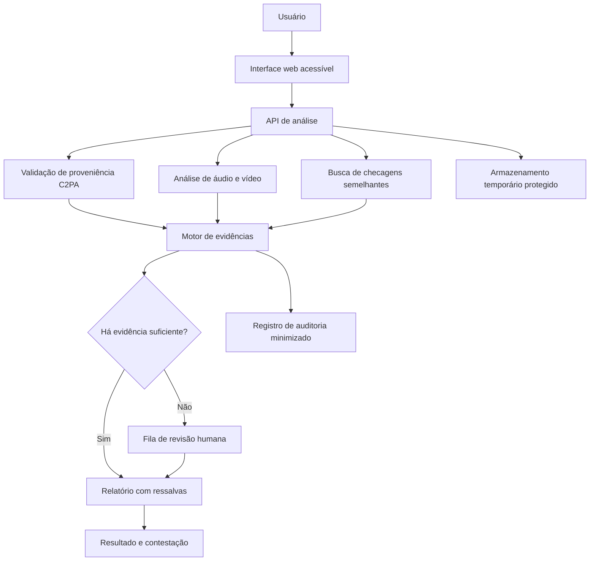

# Dossiê 4: Deepfakes e Proveniência de Conteúdo

## Integrantes

| Nome completo | RGM | GitHub | Área de carreira |
|---|---|---|---|
| Albert dos Santos Mariano| 47857927 | AlbertdosSantosMariano | Engenharia de Dados
| Gabriel Anjos Albuquerque | 48037931 | Nerd8im | Engenharia de Dados
| João Pedro Theodoro de Sousa Andrade| 47863251 | jp-theodoro | Ciência de Dados 
| Petterson Michel Lima Aguilar | 47859792 | PettersonAguilar | Engenharia de Dados
| Samuel Carmoni de Oliveira | 47813733 |carmonisamuel-cloud | Cybersegurança
|---|---|---|---|

### Apresentação do projeto

A evolução da inteligência artificial generativa tornou possível produzir áudios e vídeos sintéticos capazes de simular falas, aparências e comportamentos de pessoas reais. Essa tecnologia apresenta aplicações legítimas, mas também pode ser utilizada para fraudes, manipulação de informações e desinformação.

O Dossiê 4 propõe investigar como identificar conteúdos manipulados e verificar sua origem, considerando limitações tecnológicas, riscos éticos e impactos sociais.

**Recorte proposto:** Verificação de áudios e vídeos de caráter político-eleitoral compartilhados em redes sociais e aplicativos de mensagens no Brasil.

**Justificativa do recorte:** A circulação rápida desses conteúdos pode dificultar a verificação antes que uma informação falsa produza impactos sociais. O problema exige combinar Ciência de Dados, Cibersegurança, Engenharia de Dados, Computação em Nuvem e mecanismos de revisão humana.

**Proposta inicial:** Desenvolver conceitualmente o VerificaBR, uma plataforma de verificação assistida que combina análise de proveniência digital, detecção probabilística de manipulações, comparação com checagens anteriores e revisão humana.

**Pergunta central:**

> É melhor detectar o conteúdo falso ou comprovar a origem do verdadeiro? Como agir quando a tecnologia não consegue determinar a autenticidade com segurança?

## 1. Análise do problema

**Responsável:** Gabriel Anjos Albuquerque

### 1.1 Quem é afetado, onde e quanto?

Os deepfakes podem afetar diferentes grupos sociais, especialmente quando são utilizados para simular declarações, divulgar acontecimentos inexistentes ou manipular a percepção pública.

**Grupos potencialmente afetados:**

- Eleitores expostos a conteúdos políticos manipulados.
- Pessoas idosas e usuários com menor familiaridade digital.
- Jornalistas e profissionais de checagem.
- Pessoas que tiveram imagem ou voz falsificadas.
- Plataformas digitais e aplicativos de mensagens.
- Instituições públicas, incluindo a Justiça Eleitoral.

**Contexto brasileiro:**

Um levantamento de 2026 da Data Privacy Brasil e do Aláfia Lab registrou 413 casos de uso de inteligência artificial em publicações políticas entre janeiro e agosto de 2026, incluindo 336 envolvendo manipulações de imagem ou áudio de pessoas públicas.

Fonte: [Data Privacy Brasil — IA na pré-eleição de 2026](https://www.dataprivacybr.org/documentos/ia-na-pre-eleicao-deepfakes-desinformacao-e-novos-desafios-para-a-integridade-das-eleicoes-de-2026/).

Esses números correspondem ao monitoramento citado, não a uma estimativa de todos os deepfakes existentes no país.

**[PESQUISAR — RESPONSÁVEL]**

- Acrescentar pelo menos dois exemplos documentados no Brasil.
- Apresentar dados quantitativos recentes com fontes.
- Explicar a população observada e as limitações dos levantamentos.
- Descrever consequências sociais, econômicas ou institucionais.
- Relacionar o problema com o recorte escolhido.

**Texto a desenvolver:**

[Inserir análise própria do integrante, com dados e referências.]

### 1.2 Quais são as causas técnicas do problema?

A produção de conteúdos sintéticos tornou-se mais acessível com o avanço dos modelos generativos de áudio e vídeo.

Entre as principais dificuldades técnicas estão:

1. Modelos de síntese de voz e imagem cada vez mais convincentes.
2. Compartilhamento rápido de conteúdos sem verificação prévia.
3. Perda de metadados durante compressão, edição e reenvio.
4. Ausência de adoção universal de padrões de proveniência.
5. Limitações de generalização dos detectores automáticos.
6. Possíveis diferenças de desempenho entre sotaques, idiomas e condições de gravação.

Um estudo denominado *Deepfake-Eval-2024*, divulgado em 2025, mostrou que o desempenho de detectores pode cair consideravelmente quando são avaliados em conteúdos reais encontrados na internet, em comparação com bases acadêmicas tradicionais.

Fonte: https://doi.org/10.48550/arXiv.2503.02857

**[DESENVOLVER — RESPONSÁVEL]**

Explicar tecnicamente:

- Como funcionam deepfakes de voz e vídeo.
- O que são falsos positivos e falsos negativos.
- Por que um detector pode falhar em situações reais.
- Como compressão e reenvio afetam a análise.
- Quais riscos existem para conteúdos em português brasileiro.

### 1.3 O que já existe e por que não basta?

| Solução existente | O que faz | Limitação a investigar |
|---|---|---|
| Detectores de deepfake | Identificam sinais estatísticos de manipulação | Podem errar em conteúdos não vistos no treinamento |
| C2PA / Content Credentials | Permite verificar informações assinadas sobre origem e histórico de arquivos | Nem todo conteúdo possui credenciais; sua ausência não comprova falsidade |
| Agência Lupa | Realiza checagens jornalísticas | A análise humana exige tempo e recursos |
| Aos Fatos | Investiga informações e conteúdos suspeitos | Não cobre necessariamente todo conteúdo que circula |
| Sistemas de moderação | Aplicam políticas das plataformas | Podem apresentar falta de transparência ou decisões contestáveis |

**[PESQUISAR — RESPONSÁVEL]**

- Comparar pelo menos três iniciativas com referências.
- Explicar por que nenhuma resolve integralmente o recorte.
- Identificar a oportunidade de melhoria.
- Diferenciar autenticidade técnica de veracidade da informação.

**Conclusão preliminar:**

A solução proposta não deve substituir a verificação jornalística nem tratar classificações automáticas como provas definitivas. Seu objetivo é reunir evidências para apoiar uma avaliação mais transparente.

---

## 2. Proposta tecnológica

**Responsável:** Gabriel Anjos Albuquerque

### 2.1 Como o usuário utilizaria a solução?

**Nome provisório:** VerificaBR.

**Objetivo:** oferecer uma plataforma acessível para análise assistida de áudios e vídeos suspeitos.

**Fluxo proposto:**

1. O usuário acessa a plataforma.
2. Envia um arquivo de áudio ou vídeo, ou informa um link compatível.
3. A plataforma informa as condições de privacidade e solicita a confirmação necessária.
4. O sistema verifica a existência e a validade de credenciais de proveniência.
5. Um módulo analisa possíveis sinais de manipulação.
6. O sistema pesquisa conteúdos semelhantes em uma base de checagens.
7. As evidências são reunidas em um relatório compreensível.
8. Casos inconclusivos ou de maior risco são encaminhados para revisão humana.
9. O usuário recebe o resultado e pode solicitar reavaliação.

**Estados possíveis do resultado:**

- Proveniência verificada, com descrição do que foi efetivamente comprovado.
- Indícios técnicos de manipulação.
- Conteúdo relacionado a uma checagem existente.
- Análise inconclusiva.
- Aguardando revisão humana.

**Importante:** a plataforma não deve utilizar uma simples classificação "verdadeiro" ou "falso" baseada apenas em inteligência artificial.

**[DESENVOLVER — RESPONSÁVEL]**

- Descrever uma situação realista de uso.
- Explicar o que aparece em cada tela.
- Definir como apresentar resultados incertos.
- Indicar como o usuário solicita revisão.

### 2.2 Arquitetura tecnológica

**Arquitetura conceitual sugerida:**

**Componentes propostos:**

| Componente | Função | Tecnologia possível |
|---|---|---|
| Interface | Receber arquivos e exibir análises | React ou HTML/CSS/JS |
| API | Coordenar as solicitações | Python/FastAPI |
| Verificação C2PA | Validar credenciais disponíveis | Ferramentas compatíveis com C2PA |
| Detector | Produzir sinais de manipulação | Modelos de aprendizado de máquina |
| Base de checagens | Consultar verificações anteriores | Banco de dados e busca por similaridade |
| Fila humana | Encaminhar casos complexos | Sistema de gestão de casos |
| Infraestrutura | Executar e monitorar serviços | Ambiente de nuvem |
| Auditoria | Registrar decisões e revisões | Logs protegidos e minimizados |

**Dados de entrada:** arquivo ou link, metadados técnicos disponíveis e informações estritamente necessárias à análise.

**Dados de saída:** relatório, evidências encontradas, limitações e possibilidade de contestação.

**Armazenamento:** inicialmente temporário, com prazo definido conforme finalidade, risco e requisitos legais.

**Acesso:** usuários acessam seus relatórios; revisores autorizados acessam apenas casos atribuídos; administradores possuem permissões limitadas e auditadas.

**[VALIDAR — RESPONSÁVEL]**

- Definir a arquitetura final.
- Justificar as tecnologias escolhidas.
- Explicar criptografia e controle de acesso.
- Definir armazenamento e exclusão.
- Explicar integração entre os componentes.
- Revisar o diagrama Mermaid no GitHub.

### 2.3 Contribuição das áreas profissionais

| Área | Responsabilidade na solução | Entrega técnica esperada |
|---|---|---|
| Ciência de Dados | Avaliar detectores e medir erros | Métricas, testes e análise de vieses |
| Cibersegurança | Garantir integridade e proveniência | Assinaturas, validação C2PA e controles de segurança |
| Engenharia de Dados | Organizar evidências e checagens | Pipeline de dados e mecanismo de busca |
| Cloud Computing | Garantir disponibilidade e escalabilidade | Infraestrutura, monitoramento e controle de custos |
| Gestão de Tecnologia | Organizar revisão e resposta pública | Governança, procedimentos e indicadores |

**[PREENCHER — GRUPO]**

Explicar como as áreas de carreira reais dos integrantes se complementam.

Para cada área representada no grupo, detalhar:

- O problema técnico que resolve.
- O método ou tecnologia utilizada.
- O resultado que entrega.
- A dependência em relação às outras áreas.

### 2.4 Limitações tecnológicas

A proposta apresenta limitações importantes:

- Não existe garantia de detecção perfeita.
- Conteúdos legítimos podem ser classificados incorretamente.
- Conteúdos falsificados podem escapar dos detectores.
- A ausência de credenciais C2PA não significa falsificação.
- Credenciais válidas não comprovam que uma declaração seja verdadeira.
- Modelos podem apresentar desempenho diferente conforme idioma, sotaque ou qualidade do arquivo.
- Revisões humanas podem gerar filas e custos.
- Ataques adversariais podem tentar enganar os mecanismos de análise.

**[DESENVOLVER — RESPONSÁVEL]**

Descrever quais limitações são aceitáveis, quais impediriam a implantação e como a plataforma comunicaria sua incerteza.

---

## 3. Análise ética

**Responsável:** [ Albert dos Santos Mariano ]

### 3.1 Matriz de riscos éticos

| Risco | Categoria | Impacto | Controle proposto |
|---|---|---|---|
| Conteúdo verdadeiro classificado como manipulado | Justiça e reputação | Alto | Revisão humana e contestação |
| Deepfake não identificado | Segurança e informação | Alto | Combinar evidências e comunicar incerteza |
| Desempenho desigual por sotaque | Viés e discriminação | Alto | Testes por grupos e condições de gravação |
| Vazamento de vídeos privados | Privacidade | Alto | Criptografia, acesso restrito e retenção limitada |
| Coleta excessiva de dados | Proteção de dados | Alto | Minimização e descarte |
| Manipulação adversarial do detector | Segurança | Alto | Testes de robustez e monitoramento |
| C2PA interpretado como prova da verdade | Transparência | Alto | Explicação clara do significado da credencial |
| Uso político enviesado da plataforma | Governança | Alto | Critérios públicos, auditoria e revisão independente |

**[DETALHANDO]**

Detalhando probabilidade e gravidade de cada risco, quem pode ser prejudicado, explicar como cada controle seria verificado. 

- **Conteúdo verdadeiro classificado como manipulado:**
  Probabilidade média e gravidade alta de danos reputacionais e censura indevida, Criadores de conteúdo, jorbalistas e utilizadores legítimos serão os mais prejudicados. (Revisão humana e contestação): Verificado por meio de auditorias semanais de solicitações de contestação aprovadas e medição da taxa de falsos positivos

- **Deepfake não identificado:**
  Probabilidade média e alta e gravidade critica de disseminação em larga escala. O público em geral, figuras públicas e alvos diretos de desinformação serão prejudicados. Combinar evidências e comunicar incerteza): Verificado mediante testes de estresse na API de deteção e checagem da interface para assegurar que a incerteza é exibida claramente. 

- **Desempenho desigual por sotaque:**
  Probabilidade alta e gravidade alta de discriminação e exclusão regional. Grupos minoritários e utilizadores de regiões com sotaques menos representados serão mais afetados. (Testes por grupos e condições de gravação): Verificado através da avaliação de métricas de precisão segmentadas por dados demográficos e variações de áudio.  

- **Vazamento de vídeos privados:**
  Probabilidade baixa e média e gravidade muito alta da violação de privacidade e impactos legais. Utilizadores da plataforma e consumidores de notícias, são os públicos mais prejudicados. (Criptografia, acesso restrito e retenção limitada): Verificado por testes de penetração (pentests), auditorias de permissão (IAM) e rotinas automáticas de exclusão de dados. 

- **Coleta excessiva de dados:**
  Probabilidade média e gravidade média e alta de desconformidade com a LGPD. Todos que interagem com o sistemas serão prejudicados. (Minimização e descarte): Verificado mediante revisão do pipeline de engenharia para confirmar que apenas os metadados estritamente necessários são armazenados. (Testes de robustez e monitoramento): Verificado por simulações periódicas de ataques e monitorização contínua de anomalias no tráfego.  

- **Manipulação adversarial do detector:**
  Probabilidade alta de ataques intencionais e gravidade alta de perca de eficácia do sistema. A plataforma e a integridade da informação pública serão afetadas

- **C2PA interpretado como prova da verdade:**
  Probabilidade alta confusão entre proveniência e veracidade factual, e gravidade média e alta. Utilizadores das plataformas e consumidores de notícias não terão segurança 100%.  (Explicação clara do significado da credencial): Verificado por testes de usabilidade e inquéritos de compreensão com utilizadores sobre os selos de procedência.

- **Uso político enviesado da plataforma:**
- Probabilidade média e gravidade crítica, com riscos de interferência política ou eleitoral. A sociedade, partidos políticos e a neutralidade institucional serão afetadas. (Critérios públicos, auditoria e revisão independente): Verificado através da publicação de relatórios transparentes e auditorias externas realizadas por terceiros.

### 3.2 Decisão ética de implantação

**Decisão preliminar: implantar somente com controles.**

A solução não deve ser lançada como ferramenta de julgamento automático da veracidade de conteúdos. Uma implantação piloto dependeria de validação dos modelos, testes de viés, mecanismos de proteção de dados, revisão humana e canal de contestação. Resultados incertos devem ser apresentados como inconclusivos. Casos de maior impacto reputacional ou eleitoral exigem procedimentos reforçados. A continuidade do projeto dependeria das evidências obtidas durante os testes.

**[REVISAR — GRUPO]** Confirmar a decisão e manter a justificativa final em até 10 linhas.

### 3.3 Controles éticos obrigatórios

| Controle | Como funcionaria | Responsável | Evidência verificável |
|---|---|---|---|
| Transparência | Exibir critérios e limitações da análise | [Nome] | Exemplo de relatório |
| Revisão humana | Encaminhar casos críticos ou incertos | [Nome] | Procedimento e registro de revisão |
| Minimização | Coletar apenas dados necessários | [Nome] | Inventário de dados |
| Segurança | Aplicar criptografia e controle de acesso | [Nome] | Checklist de segurança |
| Teste de viés | Comparar taxas de erro entre grupos | [Nome] | Relatório de avaliação |
| Contestação | Permitir revisão de decisões | [Nome] | Fluxo de contestação |
| Auditoria | Registrar alterações e justificativas | [Nome] | Exemplo de trilha de auditoria |

**[DESENVOLVER — RESPONSÁVEL]**

Especificar a frequência de cada controle, os responsáveis e os critérios para verificar sua eficácia.

### 3.4 LGPD e proteção de dados

A Lei Geral de Proteção de Dados deve orientar a coleta, o tratamento, o compartilhamento e a exclusão de informações pessoais.

A base legal de cada operação depende da finalidade e do contexto concreto. Ela não deve ser escolhida automaticamente.

| Dado tratado | Finalidade | Base legal | Prazo de retenção |
|---|---|---|---|
| Arquivo enviado | Realizar análise técnica | [AVALIAR] | [DEFINIR] |
| Metadados do arquivo | Verificar características e proveniência | [AVALIAR] | [DEFINIR] |
| Identificador de solicitação | Permitir acompanhamento | [AVALIAR] | [DEFINIR] |
| Evidências da análise | Justificar o resultado | [AVALIAR] | [DEFINIR] |
| Registro de contestação | Reavaliar decisões | [AVALIAR] | [DEFINIR] |
| Logs de segurança | Proteger a infraestrutura | [AVALIAR] | [DEFINIR] |

**Dados sensíveis e menores de idade:**

Áudios e vídeos podem conter informações pessoais e, dependendo do tratamento, dados biométricos sensíveis. Também podem envolver crianças e adolescentes.

**[PESQUISAR — RESPONSÁVEL]**

- Identificar o controlador e possíveis operadores.
- Justificar cada base legal aplicável.
- Diferenciar dados pessoais comuns e sensíveis.
- Definir critérios de retenção e descarte.
- Descrever procedimentos para conteúdos envolvendo menores.
- Avaliar direitos dos titulares.
- Considerar a necessidade de relatório de impacto à proteção de dados.

Referência: [ANPD — Nota Técnica nº 1/2026](https://www.gov.br/anpd/pt-br/centrais-de-conteudo/documentos-tecnicos-orientativos/nota-tecnica-no-1-2026-fis-cgf-anpd.pdf).

### 3.5 Comunicado público para LinkedIn

**Exemplo provisório — 397 caracteres, incluindo espaços:**

> O VerificaBR é uma proposta acadêmica de verificação assistida de áudios e vídeos suspeitos. O sistema consulta registros de proveniência, compara sinais técnicos e encaminha casos incertos à revisão humana. Nenhuma classificação automática é prova definitiva. Usuários podem entender os motivos da análise e contestar resultados. A ferramenta prioriza privacidade, acessibilidade e transparência.

**[REVISAR — RESPONSÁVEL]**

- Limite máximo: 600 caracteres.
- Conferir a contagem após alterações.
- Manter linguagem acessível ao público.
- Evitar prometer precisão absoluta.

---

## 4. Acessibilidade e inclusão digital

**Responsável:** Samuel Carmoni de Oliveira

O VerificaBR atende conteúdos político-eleitorais que chegam, em geral, por WhatsApp e redes sociais. Quem recebe esse conteúdo é muito diverso: eleitores de todas as idades, muitos com celular simples, internet limitada e pouca familiaridade digital. A acessibilidade, portanto, não é um detalhe do projeto: se o resultado não for compreendido por essas pessoas, a ferramenta não cumpre a função de reduzir os danos da desinformação.

### 4.1 Quem poderia ser excluído?

#### 4.1.1 Grupos e barreiras

- **Pessoas cegas.** Barreira: interface só visual e gráficos de "nível de confiança" sem descrição. O que a solução faz: compatibilidade com leitores de tela, resultado sempre em texto e descrição textual dos gráficos.
- **Pessoas com baixa visão.** Barreira: texto pequeno, contraste insuficiente e tela quebrada ao ampliar. O que a solução faz: contraste mínimo, texto ampliável até 200% sem perda de função e nenhuma dependência de cor.
- **Pessoas surdas.** Barreira: vídeos de ajuda e orientações apenas em áudio. O que a solução faz: legenda e transcrição em todo conteúdo de ajuda, com janela de Libras (por exemplo, o VLibras) como meta.
- **Pessoas idosas.** Barreira: muitos passos, medo de errar e linguagem técnica. O que a solução faz: fluxo de 3 passos (enviar, aguardar, ver resultado), botões grandes e exemplo na tela inicial.
- **Pessoas com internet limitada.** Barreira: envio de vídeo pesado, páginas lentas e franquia de dados curta. O que a solução faz: interface leve, aviso de consumo antes do envio, limites de tamanho e envio com retomada (ver 4.1.3).
- **Pessoas com baixa alfabetização digital.** Barreira: termos como "proveniência", "C2PA" ou "modelo de IA". O que a solução faz: frases curtas e exemplos, deixando os termos técnicos em um "saiba mais" opcional.
- **Pessoas com limitações motoras.** Barreira: arrastar arquivo com mouse e botões pequenos. O que a solução faz: envio por botão, navegação completa por teclado e alvos grandes.
- **Pessoas com celular simples ou sem smartphone próprio.** Barreira: não instalam aplicativo e têm pouco espaço de armazenamento. O que a solução faz: solução web, sem instalação, que funciona em navegador comum e em telas pequenas.
- **Pessoas com deficiência cognitiva ou dificuldade de leitura.** Barreira: excesso de informação e linguagem abstrata. O que a solução faz: resumo de uma frase no topo, detalhes abaixo e nenhum tempo-limite curto para concluir ações.

#### 4.1.2 Barreiras específicas do recorte (político-eleitoral, WhatsApp e redes sociais)

- **O conteúdo costuma estar no WhatsApp e não tem link.** O usuário precisa salvar o áudio ou vídeo no celular e enviar o arquivo. Isso é uma barreira para quem não sabe localizar arquivos. A interface terá instruções curtas, com imagens e texto, de como encaminhar o arquivo a partir do WhatsApp.
- **Formatos comuns de mensagens.** Áudios de aplicativos de mensagem usam formatos próprios. A plataforma deve aceitar os formatos mais comuns de áudio e vídeo desses aplicativos e dizer claramente, em texto, quando o formato não é aceito.
- **Pressa e emoção.** Conteúdo eleitoral circula rápido e gera reação forte. O resultado deve evitar linguagem alarmista e deixar claro o que a ferramenta sabe e o que não sabe.
- **Confiança política.** O usuário pode rejeitar um resultado que contraria o que ele acredita. A explicação deve mostrar as evidências em linguagem simples e oferecer revisão humana, sem tom de acusação.
- **Privacidade.** Muitos usuários vão enviar conteúdo que receberam de conhecidos. A plataforma deve avisar, antes do envio, que o arquivo pode conter dados de terceiros e o que será feito com ele (ligação com a seção 3.4).

#### 4.1.3 Alternativas para conexões lentas

1. Mostrar, antes do envio, o tamanho do arquivo e uma estimativa de consumo de dados.
2. Aplicar limites de tamanho e duração (valores iniciais a validar com Ciência de Dados e Cloud, por exemplo 50 MB e 3 minutos), com aviso claro quando o arquivo passar do limite. Isso também reduz o custo ambiental (seção 5).
3. Permitir enviar só o trecho suspeito, em vez do vídeo inteiro.
4. Envio com retomada: se a conexão cair, o usuário continua de onde parou.
5. Não manter a pessoa esperando na tela: o resultado fica disponível por um **código de acompanhamento**, e o usuário pode fechar a página e voltar depois.
6. **Modo leve:** página só com texto, sem imagens decorativas e sem vídeo automático.
7. Quando o conteúdo já estiver publicado, aceitar o link em vez do arquivo, para evitar o envio.

#### 4.1.4 Como o usuário recebe o resultado

- O resultado aparece na tela, em **texto**, com um resumo de uma frase no topo e os detalhes abaixo.
- O estado do resultado é sempre escrito, nunca só por cor, som ou ícone.
- O usuário pode voltar ao resultado usando o código de acompanhamento, **sem precisar criar conta**. Isso também ajuda a minimização de dados (seção 3.3).
- Notificações por telefone ou e-mail só existiriam se o usuário pedisse, porque exigem coletar mais dados pessoais.
- Todo resultado informa o que a ferramenta **não** sabe e como pedir **revisão humana** (canal de contestação da seção 3).

Frases-modelo para cada estado do resultado, em linguagem simples:

- **Proveniência verificada:** "Este arquivo tem registro de origem válido. Isso mostra quem o criou e se foi alterado depois. Não prova que o que é dito nele seja verdade."
- **Indícios técnicos de manipulação:** "Encontramos sinais de que este conteúdo pode ter sido alterado ou criado por computador. Isso não é prova. Você pode pedir a análise de uma pessoa."
- **Relacionado a uma checagem existente:** "Um conteúdo parecido já foi analisado por uma organização de checagem. Veja a análise completa no link."
- **Análise inconclusiva:** "Não conseguimos saber. Isso não quer dizer que seja verdadeiro nem falso."
- **Aguardando revisão humana:** "Uma pessoa está analisando este conteúdo. Guarde o seu código para ver o resultado depois."

#### 4.1.5 Testes com participantes representativos

- **Quem:** de 5 a 8 pessoas por perfil prioritário: pessoa idosa, pessoa cega ou com baixa visão (usando leitor de tela), pessoa com celular simples ou internet limitada, pessoa com baixa familiaridade digital. Se o grupo só conseguir testar com colegas e familiares, isso deve ser dito de forma clara no texto, e o teste com os perfis acima fica como etapa obrigatória antes do piloto.
- **Tarefas reais:** "envie este áudio e me diga o que o resultado significa", "volte ao resultado de ontem usando o código", "peça revisão humana".
- **O que medir:** se concluiu sem ajuda, tempo gasto, número de erros e se conseguiu explicar o resultado com as próprias palavras (compreensão, não só uso).
- **Conteúdo do teste:** arquivos fictícios criados pelo grupo, claramente identificados como simulação, e sem candidatos ou partidos reais. Assim se evita influência política e o uso de dados pessoais de terceiros.
- **Privacidade:** participação voluntária, com consentimento e coleta mínima de dados.
- **Depois do teste:** os problemas viram correções antes de qualquer ampliação, e o teste é repetido. Os resultados alimentam o indicador "Acessibilidade" da seção 6.1.

### 4.2 Critérios concretos de acessibilidade

Referência: WCAG 2.2, do W3C. Nível de conformidade alvo: **AA**.

#### 4.2.1 Critérios, como testar e como corrigir

**1.1.1 Conteúdo não textual**
- Aplicação: gráficos e ícones de resultado têm texto alternativo útil. Imagens decorativas ficam sem descrição.
- Como testar: axe DevTools, WAVE e leitor de tela.
- Se falhar: escrever o texto alternativo ou a descrição. Marcar as decorativas com `alt=""`.

**1.2.2 Legendas pré-gravadas**
- Aplicação: vídeos de ajuda com legenda.
- Como testar: assistir sem som e revisar.
- Se falhar: corrigir ou adicionar a legenda antes de publicar.

**1.4.1 Uso de cor**
- Aplicação: os estados do resultado nunca dependem só de cor.
- Como testar: revisão manual e simulação de daltonismo.
- Se falhar: adicionar texto e ícone com rótulo.

**1.4.3 Contraste mínimo**
- Aplicação: texto com contraste de pelo menos 4,5:1.
- Como testar: Colour Contrast Analyser e Lighthouse.
- Se falhar: ajustar as cores no design.

**1.4.4 Redimensionar texto**
- Aplicação: ampliar até 200% sem perder conteúdo ou função.
- Como testar: zoom do navegador e do sistema.
- Se falhar: usar unidades relativas e layout flexível.

**2.1.1 Teclado**
- Aplicação: todo o fluxo, inclusive o envio, funciona com Tab, Enter, Espaço e Esc.
- Como testar: teste manual completo só com teclado.
- Se falhar: trocar elementos sem foco por botões e links nativos.

**2.2.1 Tempo ajustável**
- Aplicação: sem sessão que expire durante o envio. O código de acompanhamento permite retomar.
- Como testar: teste manual com envio lento.
- Se falhar: aumentar ou remover o limite de tempo.

**2.4.7 Foco visível**
- Aplicação: o elemento ativo é sempre visível.
- Como testar: navegação por teclado e revisão visual.
- Se falhar: criar um contorno de foco claro.

**2.5.8 Tamanho do alvo**
- Aplicação: botões e links com pelo menos 24×24 px CSS, ou espaçamento equivalente.
- Como testar: inspetor do navegador.
- Se falhar: aumentar a área clicável ou o espaçamento.

**3.3.1 Identificação de erros**
- Aplicação: erros como "arquivo grande demais" ou "formato não aceito" aparecem em texto, dizendo como corrigir.
- Como testar: provocar cada erro e ler com leitor de tela.
- Se falhar: reescrever a mensagem em texto, ligada ao campo.

**3.3.8 Autenticação acessível**
- Aplicação: sem conta obrigatória. O código de acompanhamento pode ser copiado e colado. Sem CAPTCHA que exija resolver desafio.
- Como testar: revisão do fluxo e teste com gerenciador de senhas.
- Se falhar: permitir colar, evitar testes cognitivos e usar limite de requisições no servidor.

**4.1.3 Mensagens de status**
- Aplicação: "Enviando", "Analisando" e "Resultado pronto" são anunciados ao leitor de tela.
- Como testar: teste com NVDA e TalkBack.
- Se falhar: marcar as mensagens com regiões de status (`aria-live`).

#### 4.2.2 Rotina de teste

1. **Automático, a cada versão:** axe e Lighthouse. Encontram só parte dos problemas, então não bastam sozinhos.
2. **Manual:** teclado completo, zoom de 200%, simulação de baixa conexão e leitor de tela (NVDA no computador, TalkBack no Android, VoiceOver no iPhone).
3. **Com usuários reais:** conforme a seção 4.1.5.
4. **Revisão de linguagem:** conferir se os textos do resultado estão em frases curtas, sem jargão, e se a ressalva de incerteza aparece em todos os estados.

#### 4.2.3 Como corrigir as falhas

- Cada falha vira uma tarefa no repositório com: critério violado, onde ocorre, gravidade e responsável.
- Falhas que impedem concluir o fluxo (por exemplo, não dá para enviar o arquivo pelo teclado) **bloqueiam a liberação** de uma nova versão.
- A tarefa só é fechada depois de testar novamente.
- Também é necessário reavaliar a acessibilidade quando o relatório ou a interface mudarem.

#### 4.2.4 Limitações assumidas

O grupo não afirma que a plataforma será 100% acessível: a conformidade com WCAG 2.2 AA é uma meta, verificada por testes automáticos, manuais e com usuários. Se não for possível oferecer Libras no piloto, isso será dito de forma explícita, junto com a alternativa (legenda e transcrição).
---

## 5. Sustentabilidade

**Responsável:** João Pedro Theodoro de Sousa Andrade

### 5.1 Sustentabilidade ambiental

O processamento de vídeos e áudios por modelos de inteligência artificial pode exigir recursos computacionais significativos.

**Medidas propostas:**

- Evitar executar modelos pesados quando não forem necessários.
- Verificar proveniência e checagens existentes antes de iniciar análises custosas.
- Aplicar limites de tamanho e duração dos arquivos.
- Excluir dados temporários após o prazo definido.
- Monitorar consumo de processamento e armazenamento.
- Avaliar serviços de nuvem com indicadores ambientais disponíveis.

**[PREENCHER]** Definir métricas ambientais e explicar como seriam acompanhadas.

### 5.2 Sustentabilidade técnica e manutenção

**Medidas propostas:**

- Documentação de componentes e dependências.
- Atualizações periódicas de segurança.
- Monitoramento de desempenho dos modelos.
- Reavaliação dos conjuntos de teste.
- Revisão de incidentes e reclamações.
- Procedimentos para substituição de tecnologias obsoletas.

**[PREENCHER]** Definir responsáveis, frequência e custos de manutenção.

### 5.3 Sustentabilidade financeira após o primeiro ano

**Possibilidades a avaliar:**

- Parcerias com instituições de pesquisa.
- Apoio a projetos de educação midiática.
- Financiamento institucional.
- Convênios com organizações de checagem.
- Serviços especializados, sem comprometer a independência da análise.

| Categoria de custo | Estimativa mensal | Justificativa |
|---|---|---|
| Hospedagem | [R$] | [PREENCHER] |
| Processamento de IA | [R$] | [PREENCHER] |
| Armazenamento | [R$] | [PREENCHER] |
| Segurança | [R$] | [PREENCHER] |
| Revisão humana | [R$] | [PREENCHER] |
| Manutenção | [R$] | [PREENCHER] |

**[DESENVOLVER]** Explicar como o projeto continuaria após 12 meses e quais condições poderiam inviabilizá-lo.

---

## 6. Impacto esperado

**Responsável:** Petterson Michel Lima Aguilar

### 6.1 Indicadores de resultado

As metas abaixo são hipóteses acadêmicas para um piloto. Não representam resultados obtidos.

| Indicador | Como medir | Meta inicial proposta |
|---|---|---|
| Tempo de análise | Mediana do tempo por solicitação | [Definir após teste] |
| Taxa de falsos positivos | Casos legítimos sinalizados incorretamente | [Definir limite aceitável] |
| Taxa de falsos negativos | Deepfakes não identificados | [Definir limite aceitável] |
| Taxa de inconclusivos | Análises sem evidência suficiente | [Definir meta] |
| Satisfação do usuário | Pesquisa após a utilização | [Definir meta] |
| Acessibilidade | Testes WCAG e com usuários | [Definir meta] |
| Contestação | Tempo e resolução das solicitações | [Definir meta] |
| Custo por análise | Gasto total dividido por análises | [Definir meta] |

**[DESENVOLVER — RESPONSÁVEL]**

- Definir metas numéricas realistas.
- Informar a linha de base, quando disponível.
- Explicar como serão coletados os dados.
- Indicar a periodicidade das avaliações.
- Separar resultados técnicos de impactos sociais.

### 6.2 Como ouvir os usuários?

**Métodos propostos:**

- Entrevistas com usuários do público-alvo.
- Testes de usabilidade.
- Questionários de compreensão dos relatórios.
- Canal de feedback e contestação.
- Avaliação com profissionais de checagem.

**[PREENCHER]** Definir participantes, perguntas, critérios de seleção e cuidados com privacidade.

### 6.3 E se a adesão for baixa?

Caso a utilização fique abaixo do esperado, o grupo propõe:

1. Investigar barreiras de acesso.
2. Avaliar a compreensão dos resultados.
3. Reduzir etapas desnecessárias.
4. Melhorar comunicação e acessibilidade.
5. Reavaliar o público-alvo.
6. Verificar se o benefício percebido justifica o esforço de uso.

**[DESENVOLVER]** Definir qual indicador acionaria uma revisão da proposta e quando seria considerada sua descontinuação.

---

## 7. Quadro de decisões

**Responsável:** Petterson Michel Lima Aguilar

| Decisão | Alternativas consideradas | Justificativa preliminar |
|---|---|---|
| Combinar proveniência e detecção | Apenas detector ou apenas C2PA | Reduz dependência de um único mecanismo |
| Incluir resultado inconclusivo | Classificação binária | Evita apresentar certeza indevida |
| Utilizar revisão humana | Automação integral | Permite examinar casos complexos |
| Minimizar armazenamento | Guardar todos os arquivos | Reduz exposição de dados pessoais |
| Priorizar interface web | Aplicativo nativo | Facilita acesso inicial multiplataforma |
| Criar canal de contestação | Resultado sem revisão | Permite corrigir decisões questionáveis |
| Fazer implantação piloto | Lançamento público imediato | Permite avaliar riscos antes de ampliar o uso |

**[DESENVOLVER — GRUPO]**

Para cada decisão:

- Explicar as alternativas reais.
- Apresentar vantagens e desvantagens.
- Indicar evidências que sustentam a escolha.
- Registrar quem participou da decisão.
- Revisar se a decisão continua válida após as pesquisas.

---

## 8. Capítulos individuais

**IMPORTANTE:** cada integrante deve escrever seu próprio capítulo. Os capítulos precisam demonstrar contribuições verificáveis, competências, metas SMART e feedback coletivo.

### 8.1 Capítulo individual — Albert dos Santos Mariano

**Área de carreira:** Engenharia de Dados 
**GitHub:** AlbertdosSantosMariano

#### 8.1.1 Papel no projeto e entregas verificáveis

**Responsabilidades assumidas:**

[Descrever o que fez e por que sua área profissional foi importante.]

**Entregas realizadas:**

- [Entrega 1]
- [Entrega 2]
- [Entrega 3]

**Evidências no GitHub:**

- Commit: [Link]
- Pull request: [Link]

#### 8.1.2 Competências técnicas e comportamentais

| Tipo | Competências que já possuo | Competências que preciso desenvolver |
|---|---|---|
| Técnicas | [PREENCHER] | [PREENCHER] |
| Comportamentais | [PREENCHER] | [PREENCHER] |

#### 8.1.3 Plano de desenvolvimento — metas SMART

**Meta 1 (6 meses):** [Objetivo específico, mensurável, alcançável, relevante e com prazo.]

**Meta 2 (12 meses):** [Objetivo específico, mensurável, alcançável, relevante e com prazo.]

**Como comprovarei os resultados:** [Cursos, projetos, certificações, portfólio ou entregas.]

#### 8.1.4 Feedback coletivo

**Pontos fortes:** [Feedback dos colegas]

**Pontos de melhoria:** [Feedback dos colegas]

**Ações a partir do feedback:** [PREENCHER]

---

### 8.2 Capítulo individual — Gabriel Anjos Albuquerque

**Área de carreira:** Engenharia de Dados  
**GitHub:** Nerd8im
#### 8.2.1 Papel no projeto e entregas verificáveis

**Responsabilidades:** [PREENCHER]

**Entregas realizadas:**

- [Entrega 1]
- [Entrega 2]
- [Entrega 3]

**Commits e pull requests:** [Links]

#### 8.2.2 Competências técnicas e comportamentais

| Tipo | Já possuo | Preciso desenvolver |
|---|---|---|
| Técnicas | [PREENCHER] | [PREENCHER] |
| Comportamentais | [PREENCHER] | [PREENCHER] |

#### 8.2.3 Plano de desenvolvimento — metas SMART

**Meta de 6 meses:** [PREENCHER]

**Meta de 12 meses:** [PREENCHER]

**Indicadores, ações e evidências:** [PREENCHER]

#### 8.2.4 Feedback coletivo

**Pontos fortes:** [Feedback dos colegas]

**Pontos de melhoria:** [Feedback dos colegas]

**Ações a partir do feedback:** [PREENCHER]

---

### 8.3 Capítulo individual — João Pedro Theodoro de Sousa Andrade

**Área de carreira:** Ciência de Dadoss
**GitHub:** jp-theodoro

#### 8.3.1 Papel no projeto e entregas verificáveis

**Responsabilidades:** Formatar e organizar o arquivo, deixando organizado, facilitando a compreensão das informações. Além disso, responsável pela parte 5 (Sustentabilidade).

**Commits e pull requests:**

1º commit: Adicionar esqueleto do documento, organizando para os outros integrantes adicionarem suas partes e separar a função de cada integrante.

#### 8.3.2 Competências técnicas e comportamentais

**Competência que a solução exige:** Organização, liderança, proatividade, senso de sociedade, empatia, pensamento crítico, gestão de projetos, TI verde, entre outras competências similares.
**Já possuo:**  Organização, liderança, senso de sociedade, empatia, TI verde. 

Claro, que preciso desenvolver as outras competências para melhor desempenho!

#### 8.3.3 Plano de desenvolvimento — metas SMART

**Meta de 6 meses:** Pretendo aprofundar meus conhecimentos sobre sustentabilidade na área de Tecnologia da Informação, por meio de estudos e da realização de pelo menos um curso sobre TI Verde. Como resultado, pretendo elaborar um relatório identificando três estratégias para reduzir o consumo de energia, o armazenamento desnecessário e os custos operacionais da plataforma de verificação de deepfakes.

**Meta de 12 meses:** Quero desenvolver minhas competências em gestão de recursos tecnológicos e planejamento financeiro, estudando conceitos básicos de Cloud Computing e análise de custos. Meu objetivo será elaborar um planejamento de sustentabilidade para a plataforma, contendo uma estimativa de custos operacionais, pelo menos três medidas de otimização de recursos e duas possibilidades de financiamento ou parceria para garantir a continuidade do projeto.

#### 8.3.4 Feedback coletivo

**Pontos fortes:** [Feedback dos colegas]

**Pontos de melhoria:** [Feedback dos colegas]

**Ações a partir do feedback:** [PREENCHER]

---

### 8.4 Capítulo individual — Petterson Michel Lima Aguilar

**Área de carreira:** Engenharia de Dados
**GitHub:** PettersonAguilar

#### 8.4.1 Papel no projeto e entregas verificáveis

**Responsabilidades:** [PREENCHER]

**Entregas realizadas:**

- [Entrega 1]
- [Entrega 2]
- [Entrega 3]

**Commits e pull requests:** [Links]

#### 8.4.2 Competências técnicas e comportamentais

| Tipo | Já possuo | Preciso desenvolver |
|---|---|---|
| Técnicas | [PREENCHER] | [PREENCHER] |
| Comportamentais | [PREENCHER] | [PREENCHER] |

#### 8.4.3 Plano de desenvolvimento — metas SMART

**Meta de 6 meses:** [PREENCHER]

**Meta de 12 meses:** [PREENCHER]

**Indicadores, ações e evidências:** [PREENCHER]

#### 8.4.4 Feedback coletivo

**Pontos fortes:** [Feedback dos colegas]

**Pontos de melhoria:** [Feedback dos colegas]

**Ações a partir do feedback:** [PREENCHER]

---

### 8.5 Samuel Carmoni de Oliveira — Cibersegurança

**Papel no projeto:** fiquei responsável pela seção 4 (Acessibilidade e inclusão digital). Nela, pensei em quem pode ter dificuldade para usar a plataforma, como pessoas idosas, pessoas cegas ou com baixa visão e quem tem internet fraca, e no que fazer para que todos consigam usar. Meus commits: [COLE AQUI os links dos seus commits].

**Plano de desenvolvimento**

| Competência que a solução exige                             | Técnica ou comportamental | Já tenho?                                                                                                    |
|-------------------------------------------------------------|---------------------------|--------------------------------------------------------------------------------------------------------------|
| Validação de assinaturas, hashes e credenciais C2PA         | Técnica                   | Ainda não. É um selo digital que mostra de onde um arquivo veio. Preciso estudar.                            |
| Segurança de APIs e autorização por caso                    | Técnica                   | Ainda não. Estou começando em programação. Preciso estudar.                                                  |
| Tratamento de uploads, criptografia e resposta a incidentes | Técnica                   | Ainda não. Preciso aprender como proteger os arquivos que os usuários enviam.                                |
| Acessibilidade digital e testes de teclado/leitores de tela | Técnica                   | Um pouco. Estudei as regras de acessibilidade para fazer a seção 4, mas ainda não testei na prática.         |
| Comunicação e colaboração interdisciplinar                  | Comportamental            | Um pouco. Tenho experiência atendendo clientes e vendendo, mas preciso treinar a explicar assuntos técnicos. |

**Metas SMART (6 a 12 meses)**

1. **Em 6 meses:** fazer um curso básico de segurança na internet (pelo menos 12 horas, de preferência gratuito) e criar no GitHub um projeto pequeno em Python que bloqueia arquivos grandes ou de tipo errado e anota quem acessou. Evidências: certificado do curso e o projeto no GitHub com README.
2. **Em 12 meses:** testar se o protótipo do VerificaBR é seguro, com uma lista de riscos e pelo menos 8 testes, e testar se ele é fácil de usar por pessoas com deficiência, com uma ferramenta gratuita como o WAVE. Também enviar currículo para vagas de estágio em TI. Evidências: relatório no GitHub e planilha com as vagas.
---

## 9. Referências

As referências abaixo são sugestões iniciais de fontes para o Dossiê 4. O grupo deve conferir os dados, as datas e a correspondência entre as citações do texto e a lista final.

### Legislação e documentos oficiais

1. BRASIL. **Lei nº 13.709/2018 — Lei Geral de Proteção de Dados Pessoais (LGPD)**. Versão vigente. Disponível em: https://www.planalto.gov.br/ccivil_03/_ato2015-2018/2018/lei/l13709.htm

2. TRIBUNAL SUPERIOR ELEITORAL. **Resolução nº 23.610/2019**. Texto compilado vigente. Disponível em: https://www.tse.jus.br/legislacao/compilada/res/2019/resolucao-no-23-610-de-18-de-dezembro-de-2019?texto=compilado

3. TRIBUNAL SUPERIOR ELEITORAL. **Resolução nº 23.755, de 2 de março de 2026**. Disponível em: https://www.tse.jus.br/legislacao/compilada/res/2026/resolucao-no-23-755-de-2-de-marco-de-2026

4. AUTORIDADE NACIONAL DE PROTEÇÃO DE DADOS. **Nota Técnica nº 1/2026**. Disponível em: https://www.gov.br/anpd/pt-br/centrais-de-conteudo/documentos-tecnicos-orientativos/nota-tecnica-no-1-2026-fis-cgf-anpd.pdf

### Normas e especificações técnicas

5. COALITION FOR CONTENT PROVENANCE AND AUTHENTICITY. **C2PA Technical Specification, versão 2.2**. Disponível em: https://spec.c2pa.org/specifications/specifications/2.2/index.html

6. WORLD WIDE WEB CONSORTIUM. **Web Content Accessibility Guidelines (WCAG) 2.2**. Recomendação vigente. Disponível em: https://www.w3.org/TR/WCAG22/

### Pesquisas acadêmicas

7. **Deepfake-Eval-2024: A Multi-Modal In-the-Wild Benchmark of Deepfakes Circulated in 2024**. 2025. Disponível em: https://doi.org/10.48550/arXiv.2503.02857

8. **BRSpeech-DF: A Deep Fake Synthetic Speech Dataset for Portuguese Zero-Shot TTS**. 2025. Disponível em: https://aclanthology.org/2025.emnlp-main.1780.pdf

### Pesquisas e checagem de fatos no Brasil

9. DATA PRIVACY BRASIL. **IA na pré-eleição: deepfakes, desinformação e novos desafios para a integridade das eleições de 2026**. Disponível em: https://www.dataprivacybr.org/documentos/ia-na-pre-eleicao-deepfakes-desinformacao-e-novos-desafios-para-a-integridade-das-eleicoes-de-2026/

10. AGÊNCIA LUPA. **Projeto VigIA**. 2026. Disponível em: https://www.agencialupa.org/observatorio-lupa/projeto-vigia/

11. AGÊNCIA BRASIL. **Mesmo proibidos, deepfakes tomam conta das redes antes da eleição**. Outubro de 2026. Disponível em: https://agenciabrasil.ebc.com.br/geral/noticia/2026-10/mesmo-proibidos-deepfakes-tomam-conta-das-redes-antes-da-eleicao

12. AOS FATOS. **Da IA ultrarrealista ao WhatsApp, como a desinformação moldou as eleições**. Outubro de 2026. Disponível em: https://www.aosfatos.org/noticias/ia-ultrarrealista-whatsapp-desinformacao-moldou-eleicoes/

**[PREENCHER — GRUPO]**

- Acrescentar as referências utilizadas pelos integrantes.
- Conferir autoria, título, ano, URL e data de acesso.
- Priorizar publicações a partir de novembro de 2024.
- Utilizar leis e normas pela versão vigente.
- Remover referências que não tenham sido utilizadas.
- Garantir que toda afirmação quantitativa esteja acompanhada de fonte.

---

<!--
=====================================================
CHECKLIST FINAL DE ENTREGA
=====================================================

[ ok ] Grupo com 3 a 5 integrantes.
[ ok ] Integrantes em ordem alfabética.
[ok  ] Nome, RGM, GitHub e área de carreira preenchidos.
[ ok ] Dossiê e recorte justificados.
[ ] Problema com dados e fontes.
[ ] Causas técnicas aprofundadas.
[ ] Soluções existentes comparadas.
[ ] Fluxo de usuário detalhado.
[ ] Arquitetura e diagrama revisados.
[ ] Contribuição de cada área profissional explicada.
[ ] Limitações tecnológicas apresentadas.
[ ] Matriz com pelo menos 5 riscos.
[ ] Decisão ética justificada em até 10 linhas.
[ ] Pelo menos 6 controles éticos com responsável e evidência.
[ ] Tabela LGPD preenchida e validada.
[ ] Comunicado público com até 600 caracteres.
[ ] Acessibilidade com critérios WCAG concretos.
[ ] Inclusão digital discutida.
[ ] Sustentabilidade ambiental, técnica e financeira.
[ ] Métricas com metas mensuráveis.
[ ] Métodos para ouvir usuários.
[ ] Plano para baixa adesão.
[ ] Pelo menos 5 decisões justificadas.
[ ] Capítulo individual de cada integrante.
[ ] Competências técnicas e comportamentais.
[ ] Metas SMART para 6 a 12 meses.
[ ] Feedback coletivo em cada capítulo.
[ ] Referências recentes e links conferidos.
[ ] Apenas um arquivo .md para a entrega.
[ ] Repositório público novo no GitHub.
[ ] Todos os integrantes com commits próprios.
[ ] Pull requests e contribuições verificáveis.
[ ] Revisão de ortografia, coerência e formatação.
[ ] Preparação de todos para a arguição.
[ ] Entrega até 09/11/2026 às 23h59.

=====================================================
-->
